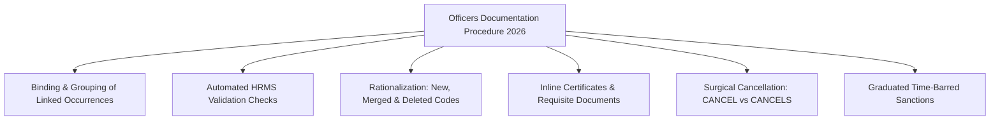
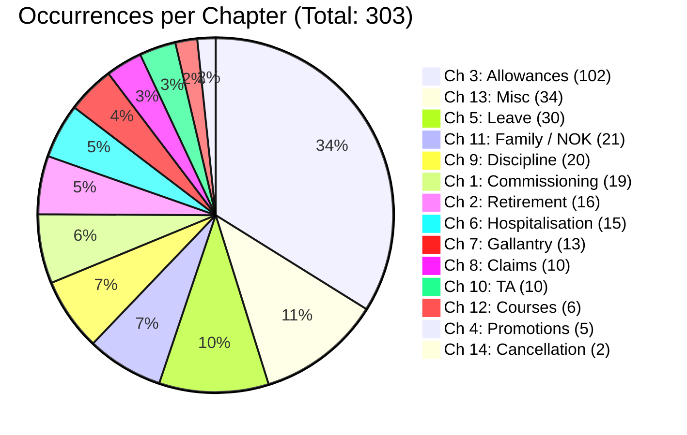
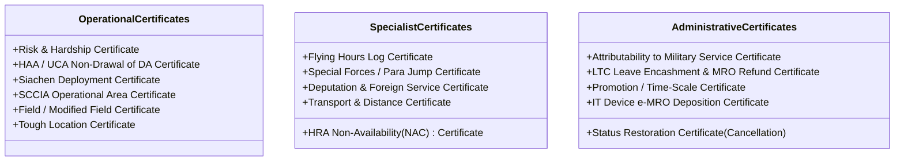

# Comprehensive Analysis: Officers Documentation Procedure for Publication of Part–II Orders (2026)

> [!WARNING]
> **Background notes, not a source.** Written before the owner Q&A of 2026-10-22 (see `DECISIONS.md`). It contains at
> least one code not in the manual (`SOSFRCRS`); its certificate wordings and timelines are not checked. Verify every
> code, link and quote against ODP-2026 itself before using it.

> [!NOTE]
> **Document Authority & Metadata:**
> - **Title:** Officers Documentation Procedure for Publication of Part–II Orders : 2026 (ODP-2026)
> - **Issuing Authority:** Integrated Headquarters of Ministry of Defence (Army), Adjutant General’s Branch, Personnel Services Directorate
> - **Collaborating Agencies:** Office of the Principal Controller of Defence Accounts (Officers) [PCDA(O), Pune] & ASDC / DGIS
> - **Format / Form Number:** IAFF-3010 (Revised)
> - **Total Volume:** 227 Pages across 14 Chapters and 3 Major Annexures
> - **Predecessor Reference:** Documentation Procedure for Officers (2014)

---

## 1. Executive Summary & Policy Context

The **Officers Documentation Procedure (2026)** is the authoritative, regulatory, and procedural compendium governing the publication, data processing, and accounting of **Daily Order Part–II (DO Part-II)** for all officers of the Indian Army. In military administration, the Part-II Order represents the primary legal instrument and source record documenting every single occurrence in an officer's career—from commissioning to retirement—directly driving pay, allowances, promotions, seniority, leave, medical records, discipline, and terminal benefits.

### Rationale for the 2026 Revision
The preceding documentation procedure was issued in **2014**. Over the past 12 years, sweeping policy developments, revised pay structures under the 7th Central Pay Commission (CPC), digitized personnel systems, and modern administrative mandates rendered the 2014 guidelines obsolete. The 2026 manual represents an exhaustive overhaul designed to synchronize Army documentation with the automated **Human Resource Management System (HRMS)** and the digital audit systems of **PCDA(O), Pune**.

---

## 2. Key Paradigm Shifts & Systemic Improvements (2026 vs. 2014)



### 2.1. Binding and Grouping of Linked Occurrences
Historically, units frequently published isolated Part-II orders for a major life or service milestone while neglecting linked mandatory administrative filings. For instance:
- **Marriage:** Under the old system, an officer might publish marriage (`MARRIAGE`) but omit notifying changes in Next of Kin (`NOKCHNG`), or updating nominations for DSOP, DCRG, and AGIF.
- **Under ODP-2026:** Related occurrence codes are bound together into single logical event workflows within HRMS (e.g., Commissioning, Marriage, Hospitalisation, Postings). The system prompts and guides the publishing authority to execute all interconnected Part-II orders synchronously.

### 2.2. Automated HRMS Validation Checks
A persistent bottleneck in Army accounting was the high rejection rate of DO Part-IIs during audit by PCDA(O), resulting in administrative backlogs, delayed disbursements, and post-facto recovery of pay and allowances. The 2026 manual incorporates **algorithmic validation checks directly into HRMS**, preventing the submission of erroneous, contradictory, or unentitled occurrences.

### 2.3. Inline Certificates and Supporting Documents
In the 2014 edition, certificates were clustered in distant appendixes (Annexure IV / V). The 2026 edition positions mandatory certificate formats and policy authority citations **directly beneath each occurrence code**, ensuring drafting officers incorporate exact legal verbiage onto the face of the order or as verified attachments.

### 2.4. Code Rationalization & Discontinuation of Obsolete Fields
- **Appointment Codes Discontinued:** In a major administrative simplification, **"Appt Code"** is no longer required to be notified in Part-II Orders (Para 8.3 Note b).
- **New Occurrences Added:** Reflecting contemporary needs, new codes have been instituted for PRAN allotment under NPS (`ALOTPRN`), IT device lifecycle management (`LAPPROC`, `LAPDISP`, `LAPDISPF`), twin child benefits (`RIMBCEAT`, `HSTSUBTD`), Divyang child claims (`REIMCEAD`, `DIVYNCHL`), and specialized monetary allowances (`GALASSPP`).
- **Merged & Deleted Codes:** Redundant legacy codes have been consolidated into dropdown selections or deleted.

### 2.5. Surgical Rejection and Cancellation Protocol
- **Item-Level Rejection:** Under Para 10.2, PCDA(O) now rejects only the erroneous or incomplete occurrence rather than invalidating the entire multi-occurrence Part-II order.
- **No Manual Amendments:** Handwritten, piecemeal, or inline amendments are strictly forbidden (Para 11).
- **Dual Cancellation Framework (Chapter 14):**
  - `CANCEL`: Cancels an entire Part-II Order *in toto*.
  - `CANCELS`: Cancels a specific serial occurrence within an order without disrupting valid sibling occurrences.

### 2.6. Graduated Time-Bar Sanction Matrix
Part-II Orders must strictly be published within **24 hours** of the occurrence (Para 6.3). Delays beyond two years are designated as "Time Barred" (Para 13 & 14):
- **Delay between 2 to 6 Years:** Sanctioning authority is GOC Div / Corps (for formations) or GOC-in-C Command (for Command HQ officers).
- **Delay exceeding 6 Years:** Competent authority is the **Adjutant General (AG)** at IHQ of MoD (Army).
- **Financial Claims (Rule 188, FR Part-I):** Claims submitted after 24 months are ordinarily deemed forfeited unless regularized with formal competent financial sanction.

---

## 3. Structural Architecture of Form IAFF-3010 (Revised)

Every Part-II Order is structured into three standardized tiers:

```
+---------------------------------------------------------------------------------------------------+
| TOP PORTION: Unit Identification, SUS No, Running DO Serial, Hierarchy & Cross-References        |
+---------------------------------------------------------------------------------------------------+
| MIDDLE PORTION: Officer Credentials, Personal No, Rank & Code, CDA(O) A/c, PAN, Arm/Corps Code   |
+---------------------------------------------------------------------------------------------------+
| LOWER PORTION: Occurrence Data Grid (Cols 1-10), From/To Dates, Data 1-4, Authority & Certificate|
+---------------------------------------------------------------------------------------------------+
```

### 3.1. Group Categorization & The "Group B Isolation Rule"
Occurrences are divided into five distinct operational groups:
1. **Group A:** Financial (Other than Claims) – directly processed by PCDA(O) for ledger adjustments.
2. **Group AM:** Financial (Other than Claims) required by MISO / automated systems.
3. **Group B:** Financial Claims (Reimbursements like CEA, Hostel Subsidy, Furniture, Transit Accn).
4. **Group C:** Non-financial (Administrative, status, family, courses).
5. **Group CM:** Non-financial required by MISO / Non-Actionable for PCDA(O) ledger.

> [!WARNING]
> **The Group B Isolation Rule (Para 7.1):**
> Occurrences belonging to **Group B (Financial Claims) must NEVER be combined with Groups A, AM, C, or CM** in the same Part-II Order. 
> Groups A, AM, C, and CM may be co-located in a single order, in which case the order assumes the prefix **Group 'A'** (or 'AM').

### 3.2. Reference Tables & Syntax Rules
- **Annual Serial Reset:** Numbering commences at `0001/YYYY` on 01 January and runs continuously through 31 December.
- **CDA(O) Account Structure:** Section (1-19) / Task (3 digits) / Account Number (6 digits + check letter), e.g., `09/149/155753H`.
- **Rank Codes (Para 8.3):**
  - Field Marshal: `F` | Gen (CDS): `0++` | Gen (COAS): `0+` | Lt Gen (VCOAS): `0`
  - Lt Gen (NFSG): `01++` | Lt Gen (HAG+): `01+` | Lt Gen: `01` | Maj Gen: `02`
  - Brig: `03` | Col: `04` | Col (TS): `15` | Lt Col: `05` | Lt Col (TS): `16`
  - Major: `06` | Captain: `07` | Lieutenant: `08`
- **Arm / Corps Code Directory (Para 8.6):**
  - Armoured (`1`), Artillery (`2`), Engineers Non-MES (`3`), Engineers MES (`4`), Signals (`5`), Infantry (`6`), ASC (`7`), AMC/ADC (`10`), MNS/Nursing (`11`), AOC (`12`), EME (`13`), RVC (`14`), Pioneers (`15`), Military Attachés (`20`), Army Air Defence (`21`), APTC (`22`), Military Farms (`23`), APS (`24`), Intelligence (`25`), AEC (`26`), CMP (`27`), DSC (`28`), Other Arms (`29`).

---

## 4. Comprehensive Chapter-by-Chapter Technical Breakdown



### Chapter 1: Commissioning & Commencement of Pay (19 Occurrences)
- **Scope:** Initial intake, grant of commissions, reporting for duty, stipend management, and return from desertion/missing/secondment.
- **Key Codes:** `GTDPC` (Permanent Commission), `GTDSSC` (SSC General), `GTDSSCMT` / `GTDSSMNT` (SSC Men Tech/Non-Tech), `GTDSSCWT` / `GTDSSWNT` (SSC Women Tech/Non-Tech), `EXTNSSC` (SSC Extension), `GTDSPLC` (Special List), `GTDSC` (Special Commission), `REPDUTY` (First Arrival), `SSCGTDPC` (SSC to PC Conversion), `GTDREMPL` / `EXTNREMP` (Re-employment & Extension), `REVDEP` / `REVSECND` (Reversion from Deputation/Secondment), `REMISSIN` / `REPDESRT` (Rejoining after missing/desertion), `GTDSTP` / `STPSTP` (Stipend grant/stoppage).
- **Mandatory Directives:** Complete Bank Account details, IFSC Code, PAN, and Aadhaar numbers are mandatory in Columns 6 to 9. GoI MoD gazette notification numbers must be cited as authority.

### Chapter 2: Retirement, Release, Deputation & Stoppage of Pay (16 Occurrences)
- **Scope:** Terminal service events, secondments, deaths, and foreign missions.
- **Key Codes:** `RELEASE` (Release from SSC/Re-employment), `RETIRE` (Superannuation), `PRETIRE` (Premature Retirement), `RESIGN` (Resignation), `PMTABSN` (Permanent Absorption in PSU/Civil), `DEATH` (Natural Death), `KILLACTN` (Killed in Action/Ops), `DESERTER` (Desertion), `INVALID` (Medical Invalidation), `MISSING` (Missing in Action/Peace), `SECNDMNT` / `PRMSECND` (Secondment to Navy/Air Force/Civil), `DEPUTE` / `DEPUOTHR` (Deputation), `SECONDUN` (UN Peacekeeping), `EMBASSY` (Defence Attaché abroad).
- **Crucial Protocols:** Absorption requires formal non-drawal certificate (`PMTABSN`). Invalidation requires DGAFMS medical board proceedings.

### Chapter 3: Allowances – Grant & Stoppage (102 Occurrences)
*This is the largest chapter in the manual, featuring strictly paired GRANT and CEASE/STOP occurrence codes to maintain financial equilibrium in PCDA(O) ledgers.*

| Allowance Category | Grant Code | Cease Code | Qualification & Certificate Rules |
| :--- | :--- | :--- | :--- |
| **7th CPC Risk & Hardship Matrix** | `GTDRH11` to `GTDRH33`, `GTDRH77`, `GTDRH60` | `STPRH` | Governed by Appendix to MoD letter; mandates certified operational unit deployment. |
| **High Altitude (HAA) / UCA** | `GTDHH11` (Cat-III), `GTDHH31` (Cat-II), `GTDHH32` (Cat-I) | `STPHH` | Unit location verification from base tables; temporary duty requires non-drawal of DA certificate. |
| **Siachen Allowance** | `GTDSICHA` | `STPSICHA` | Deployed in designated Siachen glacier sectors; signed Siachen Certificate mandated. |
| **Special Counter-Insurgency (SCCIA)** | `GTDCIAFD` (Field), `GTDCIAMF` (Mod Field), `GTDCIAPC` (Peace) | `STPSCCIA` | Specific CI operational operational areas; certified non-concurrence with overlapping field allowances. |
| **Field Allowances** | `GTDHAFA` (Highly Active), `GTDCFAA` (Field), `GTDCMFA` (Mod Field) | `STPFIELD` | Dependent on formation command notification and unit deployment grid. |
| **Tough Location Allowance (TLA)** | `GTDTLA1`, `GTDTLA2`, `GTDTLA3` | `STPTLA` | TLA I, II, III regional schedules. |
| **Aviation & Airborne** | `GTDFLPAY`, `GTDFTEA`, `GTDPARA`, `GTDPARES`, `GTDSFALC`, `GTDTPILA`, `GTDPAJIA` | `STPFLPAY`, `STPFTEA`, `STPPARA`, `STPPARES`, `STPSFALC`, `STPTPILA`, `STPPAJIA` | Annual flight hours verification, jump log verification, or Special Forces qualification certificates. |
| **Deputation & Special Duties** | `GTDDEP1` to `GTDDEP3`, `GTDDAA`, `GTDHAZ`, `GTDBCAS0`-`S3` | `STPDEP`, `STPDAA`, `STPHAZ`, `STPBCA` | Deputation terms, Difficult Area, Hazard Pay, Bhutan Compensatory Allowance. |
| **Urban & Domestic Allowances** | `GTDTRAN1`/`2`, `GTDHRAX`/`Y`/`Z` | `STPTRAN`, `STPHRA` | Distance certificate, DA slab rules, NAC (Non-Availability Certificate) for HRA. |
| **Medical Specialist & Academic** | `GTDSPLP1`-`3`, `GTDPSTDP`, `GTDPSTDG`, `GTDQPAY1`-`3`, `GTDTECI`/`II`, `GTDLNGL-I`/`II` | `STPSPLP`, `STPPSTDP`, `STPPSTDG`, `STPQPAY`, `STPLNGL` | Graded/Classified specialist lists (DGAFMS), PG degrees, Technical Qualifications, Foreign Language proficiency. |
| **Institutional & Training** | `GTDTRGA`, `GTDTRGNC`, `GTDTRGO`, `GTDNSG`, `GTDSECUR`, `GTDSTFA1`-`3` | `STPTRGA`, `STPTRGNC`, `STPTRGO`, `STPNSG`, `STPSECUR`, `STPSTFA` | Training allowance in Category A/B training establishments, NSG deputation, Special Security, Strategic Forces. |
| **Rations & Welfare** | `GTDRSHNA`, `GTDSRA`, `SORS`, `TORS`, `GTDSACC`, `GTDHARDS`, `GTDNTSSA`, `GTDSPIC` | `STPRSHNA`, `STPSRA`, `STPHARDS`, `STPNTSSA`, `STPSPIC` | RMA, Special Rations, Struck Off/Taken On Ration, Special Child Care (for disabled women officers), NTRO, SPIC. |

### Chapter 4: Promotions & Pay Fixation (5 Occurrences)
- **Scope:** Acting/Substantive promotions, appointment assumption, and pay fixation options.
- **Key Codes:** `ASMAPPT` (Assume Appointment), `RELAPPT` (Relinquish Appointment), `SUBPROM` (Substantive Promotion), `OPTFXDNI` (Pay fixation from Date of Next Increment under FR 22(I)(a)(1)), `OPTFXDOP` (Pay fixation from Date of Promotion).
- **Rule Note:** Timely exercise of fixation option within one month is critical; incorporates special certificates for Nursing Officers and Time-Scale advancements.

### Chapter 5: Leave Entitlements & Encashment (30 Occurrences)
- **Scope:** Regular leave, statutory leave, disciplinary absence, and leave encashment.
- **Key Codes:**
  - *Regular & Statutory:* `GTDAL` (Annual Leave), `GTDALCF` (Carry Forward AL), `EXTNAL` (Extension AL), `GTDCL` (Casual Leave), `GTDSPCL` (Special CL), `FURLEV` (Furlough), `MTRNLV` (Maternity - 180 days), `SPMTRNLV` (Special Maternity), `GTDCCL` (Child Care Leave), `EOL` (Extraordinary Leave without pay), `TERLEV` (Terminal Leave), `CHADPLVE` (Adoption Leave), `PTRNLV` (Paternity - 15 days), `PATLCHAD` (Paternity on Adoption), `STDLEV` (Study Leave), `STDLVAL` / `STDLVFUR` (Study leave extensions).
  - *Unauthorized Absence / Irregularity:* `OSL` (Overstaying Leave), `REJOSL` (Rejoin from OSL), `AWL` (Absent Without Leave), `REJAW` (Rejoin from AWL).
  - *Rejoining & Recall:* `REJOINAL` (Standard Rejoining), `VOLREJ` (Voluntary Rejoining), `RECALL` (Recalled from Leave).
  - *Encashment Framework:* `ACCLVE` (Leave Accumulation record), `LVELTCAD` (Advance AL Encashment for LTC), `LVELTC` (Final AL Encashment post-LTC travel - 10 days), `CLVLTCAD` (Cancellation of LTC AL Advance), `ENCASH` (Retirement Leave Encashment up to 300 days).

### Chapter 6: Hospitalisation & Medical Regularization (15 Occurrences)
- **Scope:** Clinical admissions, transfers, sick leave, and service attributability regularizations.
- **Key Codes:** `HOSADM` (Admitted), `SLHOSADM` (Admitted while on Sick Leave), `MEDTRAN` (Transferred to other hospital), `HOSDISCH` (Discharged), `SLDISCH` (Discharged with Sick Leave), `GTDSL` (Granted Sick Leave), `EXTNSL` (Sick Leave Extension beyond 120 days), `RPDUHSP` (Reported for duty/attached), `SLC` (Sick List Concession), `REGAL` (Regularization: Non-attributable to military service), `REGALMS` (Regularization: Attributable to military service), `GTDALHOS` (Absence adjusted as AL), `GTDSLHOS` (Absence adjusted as Sick Leave), `HOSFURPY` (Adjusted at furlough rate), `MEDCAT` (Medical Category upgrade/downgrade/continuation).
- **Attributability Matrix:** Regularization under `REGALMS` vs `REGAL` directly impacts pay deductions and disability entitlement calculations.

### Chapter 7: Gallantry Awards & Honours (13 Occurrences)
- **Scope:** Notifying national honours and financial allowances attached to decorations.
- **Key Codes:** `GALPVC` (Param Vir Chakra), `GALMVC` (Maha Vir Chakra), `GALAC` (Ashoka Chakra), `GALKC` (Kirti Chakra), `GALVC` (Vir Chakra), `GALSC` (Shaurya Chakra), `GALSENA` (Sena Medal - Gallantry), `GALBAR` (Bar to Chakra), `GALASSPP` (Monetary Allowance for Asadharan Suraksha Seva Praman Patra), `MEDAL` (Distinguished Medals), `FORMEDAL` (Forfeited Medal), `DISTSENA` (Sena Medal - Distinguished), `DISTGBAR` (Bar to Distinguished Medal).
- **Mandate:** All medal notifications must invariably be endorsed to PCDA(O) for publication of monetary allowance.

### Chapter 8: Claims [Group B] (10 Occurrences)
*Strictly isolated from all other groups in DO Pt II publication.*
- **Scope:** Education, domestic lodging, and transitory claims.
- **Key Codes:** `REIMBFUR` (Furniture Hire Charges), `REIMBCEA` (CEA for normal child), `RIMBCEAT` (CEA for twin children), `REIMCEAD` (CEA for Divyang child - payable at double rate), `REMCEATD` (CEA for Divyang twins), `HOSTSUB` (Hostel Subsidy normal), `HOSTSUBT` (Hostel Subsidy twins), `HOSTSUBD` (Hostel Subsidy Divyang), `HSTSUBTD` (Hostel Subsidy Divyang twins), `REIMACCN` (Reimbursement of Transit / Mess / Holiday Home accommodation).
- **Compliance:** Mandates tuition fee receipts, school bonafide certificates, and non-accommodation certificates from station commanders.

### Chapter 9: Discipline & Legal Proceedings (20 Occurrences)
- **Scope:** Disciplinary attachments, arrests, judicial sentences, pay withholding, and punitive exits.
- **Key Codes:** `ATTDIS` / `REJATDIS` (Attachment / Rejoining on Disciplinary Grounds), `SUSARST` / `RESUARST` (Suspension / Close/Open Arrest & Removal), `SUSPNDTY` / `RESUSPND` (Suspension from Duty & Removal), `WTHDPAY` / `RWTHDPAY` (Withholding of Pay % and Restoration), `GCMAWARD` (General Court Martial Sentence), `REPRIMND` (Reprimand), `SREPRMND` (Severe Reprimand), `CONVCT` (Civil Court Conviction), `FORFEIT` (Forfeiture of Service for Pay), `PENLDEDN` (Penal Deductions under Army Act), `COMPRETD` (Compulsory Retirement), `DISMISS` (Dismissal), `TERMN` (Termination), `REMOVE` (Removal), `CASHRNG` (Cashiering), `REINSTTS` (Reinstatement).

### Chapter 10: Territorial Army (10 Occurrences)
- **Scope:** TA officer commissions, embodiment under various TA Rules, camps, and relinquishment.
- **Key Codes:** `GTDTAC` (TA Commission), `TAEMB` (Embodied under Rule 19/20/21/21A/33), `TADISEMB` (Disembodied), `ATC` (Annual Training Camp embodiment), `EXTN` (Extension of permanent staff), `SUL` (Supernumerary Unemployed List placement/rejoining), `TADISCHG` (Discharge under Rule 14), `PCTRG20A` (Pre-Commission Training), `WAIVER1`/`2`/`3` (1st, 2nd, 3rd Waiver from ATC), `RELTAC` (Relinquished Commission).

### Chapter 11: NOK & Family Occurrences (21 Occurrences)
- **Scope:** Marital status, dependent records, life events, and legal domestic changes.
- **Key Codes:** `MARRIAGE` (Civilian spouse), `MARSEROF` (Married to Govt / Military / PSU servant), `NOK` (Initial Next of Kin), `NOKCHNG` (Change of NOK), `SEPARATE` (Legal Separation), `DIVORCE` (Divorce Decree), `REMAR` / `REMAROF` (Remarriage), `BTHCHL` (Birth of Child), `DTHSPOUS` (Death of Spouse), `DTHFAMEM` (Death of Family Member), `DTHNOK` (Death of NOK), `DTHCHL` (Death of Child), `ADOPTION` (Legal Adoption), `STEPCHLD` (Stepchild), `DIVYNCHL` (Disability / Divyang Child Notification), `DEPNDNT` (Declaration of Dependents), `CHNGNTSP` (Change of Spouse Nationality), `DOBCHNGF` (DOB change of family member), `NAMCHNG` (Name change of family member), `HOMCHNG` (Permanent Home Address change).
- **Mandatory Enclosures:** Marriage certificates, gazette notifications, court adoption deeds, and death certificates.

### Chapter 12: In-Service Courses & Training (6 Occurrences)
- **Scope:** Military courses, civil qualifications, and temporary strike-offs.
- **Key Codes:** `PROCRS` (Proceeded to Course), `REJCRS` (Rejoined from Course), `ACQUAL` (Acquired Qualification), `SOSCRS` (Struck off strength to course), `SOSCRS1` (SOS while proceeding), `SOSFRCRS` (SOS from course on return).

### Chapter 13: Miscellaneous Service Occurrences & IT Lifecycles (34 Occurrences)
- **Scope:** Postings, attachments, casualty status, antedate seniority, national identifications, and government IT equipment lifecycle.
- **Key Codes:**
  - *Postings & Moves:* `POSIN` (Posting In / TOS), `POSOUT` (Posting Out / SOS), `SPR` / `CHNGSPR` (Selected Place of Residence), `JNTIME` / `EXTRJT` (Joining Time & Extra Joining Time), `TYDUTY` (Temporary Duty), `ATCH` / `CSAT` (Attachment & Cessation).
  - *Casualties & Wounds:* `INJURY` (Sustained Injury), `BATTLCAS` (Battle Casualty Declaration), `POW` / `REPOW` (Prisoner of War / Released), `WOUNDAC` (Wounded in Action).
  - *Identity & Administrative:* `CHNGRELI` (Change of Religion), `CHNCORPS` (Transfer of Corps), `ALOTPRN` (PRAN Allotment under NPS), `FOMSERV` (Counting Former Service), `RETADD` (Retirement Address), `ANTEPROM` / `ANTEPAY` / `ANTEPEN` (Antedate Seniority for Promotion, Pay, Pension), `PAN`, `MOBILE`, `EMAILID`, `SPORTPAR` (Sports), `ACSPLACH` (Special Achievement), `LANGPRO` (Language Proficiency).
  - *Welfare Nominations:* `NOMNDCRG` (DCRG Nomination), `NOMNAGIF` (AGIF Nomination), `NOMNDSOP` (DSOP Fund Nomination).
  - *IT Device Lifecycle:* `LAPPROC` (Procurement of Laptop / Tablet / Smartphone under official IT scheme), `LAPDISP` (Retention / Disposal of IT device after useful life), `LAPDISPF` (Disposal with residual cost payment via e-MRO).

### Chapter 14: Cancellation of Part-II Orders (2 Occurrences)
- **Scope:** Annulment of previously published Part-II Orders.
- **Key Codes:**
  - `CANCEL` (14.1): Cancels an entire Part-II Order *in toto*. Data 1 is marked as `ALL`; quotes original DO Pt II Number and Date. Requires restoration certificate: *"Certified that the previous status may be restored due to cancellation of Part II Order No... dated..."*
  - `CANCELS` (14.2): Cancels a specific serial occurrence within an order. Data 1 specifies the occurrence code; Data 2 specifies the exact serial number within the target order.

---

## 5. Mandatory Certificate Compliance Directory

One of the most consequential advancements of ODP-2026 is embedding statutory certificates directly into the regulatory instructions. Failure to endorse these exact text strings on the body of the Part-II Order results in instant rejection by PCDA(O).



### Essential Certificate Wordings:
1. **Siachen Allowance:** *"Certified that the officer was physically present and deployed in the defined Siachen Glacier operational area for the specified duration and is not in receipt of conflicting field/hardship allowances."*
2. **Temporary Duty in HAA / Field Area:** *"Certified that the officer did not draw Daily Allowance (DA) during the temporary duty period in terms of AO 67/79 and is fully entitled to the specified HAA/Field Allowance."*
3. **Hospital Regularization (Attributable):** *"Certified that the disability / illness resulting in hospitalization and subsequent sick leave is directly attributable to military service conditions in terms of Entitlement Rules."*
4. **IT Device Settlement:** *"Certified that the officer has deposited the residual/depreciated book cost of the IT device through e-MRO No... dated... which is enclosed in original."*

---

## 6. Operational Playbook & Compliance Checklist for Units

### 6.1. The 24-Hour Rule & Audit Timelines
- All Part-II Orders must be published within **24 hours of occurrence**.
- Leave grants must be published within 24 hours of proceeding on leave; rejoining occurrences within 24 hours of physically reporting back.
- Assumption of appointment must be notified within 24 hours of takeover.

### 6.2. Chronological Sequence Integrity
- Occurrences pertaining to an event must be published in strict chronological order.
- Rejoining cannot precede the grant of leave; discharge cannot precede hospital admission; cessation of allowance cannot precede grant.
- Missing running serial numbers between orders will halt PCDA(O) processing for the entire unit.

### 6.3. Top Rejection Pitfalls and Prevention

| Common Error | Failure Mechanism | ODP-2026 Preventive Remedy |
| :--- | :--- | :--- |
| **Mixing Group B with Other Groups** | Order contains both CEA claim and a posting or leave entry. | Systemic rejection. Group B claims must always be published on an isolated IAFF-3010. |
| **Missing Cease / Stop Pairing** | Officer posted out of field area, but `STPRH` or `STPFIELD` was omitted. | Double credit leads to massive financial recovery and audit objection. Ensure `POSOUT` triggers linked stoppage. |
| **Absence of Mandatory e-MRO / Gazette** | Quoting internal unit letters instead of MoD / DGAFMS gazette numbers. | PCDA(O) audit rejects non-statutory authority citations. Quote MoD/DGAFMS letters only. |
| **Unsanctioned Time-Bar Entries** | Publishing occurrences older than 2 years without higher HQ sanction. | Instant rejection. Attach GOC Div/Corps sanction (2-6 yrs) or AG sanction (>6 yrs). |
| **Manual / Pen Amendments** | Pen corrections or overwriting on printouts. | Zero tolerance. Original order must be cancelled via `CANCEL` or `CANCELS` and published afresh. |

---

## 7. Strategic Impact Assessment

The **Officers Documentation Procedure – 2026** represents a major leap forward in the administrative modernism of the Indian Army:
1. **Elimination of Administrative Friction:** By shifting validation from manual PCDA(O) audit scrutiny to front-end HRMS algorithms, processing turn-around times are reduced from months to hours.
2. **Financial Rectitude & Zero Unwarranted Recoveries:** Pre-validating allowances and enforcing coupled Grant-Stoppage logic safeguards officers from unexpected pay cuts due to past overpayments.
3. **Comprehensive Career Integrity:** Binding linked events guarantees that critical life records (NOK, marital status, pension nominations, Gallantry records) are accurately preserved in the Army’s central databases without human oversight.
